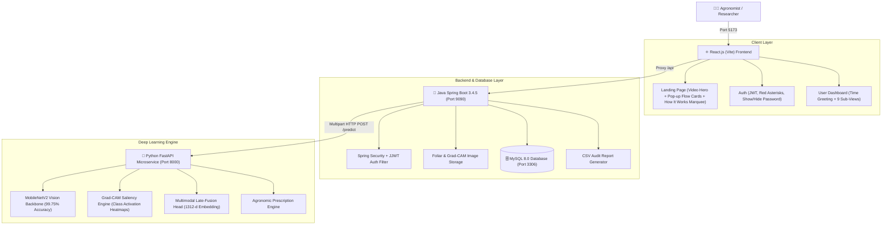

# AgroVita AI — Grow Smarter. Detect Earlier. Harvest Better.

An intuitive, farmer-first agricultural decision intelligence platform designed specifically for growers and greenhouse operators. Powered by deep learning computer vision and microclimate telemetry to detect foliar diseases early, pinpoint damaged tissue, and provide practical care instructions.

---

## 🌟 Key Highlights & System Architecture



---

## 🚀 Key System Features

### 1. Modern Interactive Frontend (`frontend/`)
- **Technology Stack**: React.js 19, Vite 8, Lucide React icons, Canvas Confetti, Custom CSS Design System.
- **Dynamic Landing Page**:
  - **15–30 Sec Video Hero**: Looping muted background video (`/videos/crop_health_hero.mp4`) with greenhouse dark overlay and fallback image.
  - **Interactive Working Flow Cards**: 4 cards with dataset background images (`/cards/*.jpg`) that dynamically pop up with glowing gradient borders and color-shifting effects on hover.
  - **Marquee "How It Works"**: Smooth scrolling marquee moving cards (Steps 1–9) with pause-on-hover interaction.
  - **About Us & Objectives Section**: Research motivations, greenhouse challenges, and biological etiology.
  - **Modern Footer**: System status badge, research citation, and quick links.
- **Authentication Pages (Login & Register)**:
  - High-resolution greenhouse glassmorphism background (`/images/auth_bg.jpg`).
  - Required fields marked with red asterisk `*` (`Full Name *`, `Email *`, `Password *`, `Confirm Password *`).
  - Interactive password show/hide eye toggles.
  - Client & server validation with immediate error banners.
- **User Dashboard (`DashboardLayout.jsx`)**:
  - **Dynamic Time-Based Greetings**: Automatically adjusts greeting based on actual local time:
    - `05:00 - 11:59`: *"Good Morning, [Username]"*
    - `12:00 - 16:59`: *"Good Afternoon, [Username]"*
    - `17:00 - 20:59`: *"Good Evening, [Username]"*
    - `21:00 - 04:59`: *"Welcome, [Username]"*
  - **Collapsible Sidebar with 9 Functional Views**:
    1. **Overview**: Key metrics, greenhouse operational status, recent assessments table, and quick actions.
    2. **New Crop Assessment**: Foliage photo upload (drag & drop / file browser, live preview), crop type selector, growth stage, observation date, inference mode selection (`image` vs `fusion`), microclimate inputs (temperature, humidity, solar radiation, wind speed), progress indicator, and celebration confetti.
    3. **Prediction Results**: Side-by-side visual explainability (Original Foliage Photo vs Grad-CAM Class Activation Heatmap Overlay), diagnostic severity badge, confidence percentage meter, alternative class candidate scores, microclimate summary, actionable agronomic recommendations, and **Download CSV Report** button.
    4. **Assessment History**: Searchable and filterable data table (by plant ID, disease class, crop type, or status), pagination, thumbnails, direct inspect button, CSV download, and delete confirmation modal.
    5. **Crop Health Analytics**: Interactive SVG charts showing pathogen prevalence distribution, daily diagnostic volume trends, healthy vs diseased ratio, and mean inference latency.
    6. **Environmental Analysis**: Microclimate telemetry target bands (VPD, Temperature, Humidity, Solar Radiation, Airflow) and interactive **Microclimate Pathogen Risk Simulator** (adjust temperature and humidity sliders to compute real-time Vapor Pressure Deficit and fungal risk level).
    7. **Model Performance**: Verified validation metrics (**99.75% accuracy**, **0.9975 macro F1**, **27.40 ms latency**), per-class precision/recall table, 8x8 confusion matrix visualization, and deep learning architecture diagram.
    8. **Dataset Information**: Comprehensive audit of authentic datasets (`MangoLeafBD`, `MH-SoyaHealthVision`, `PlantDoc`), interactive 8-class taxonomy explorer with symptoms and biological pathogens.
    9. **Profile & Settings**: User credentials, organization, tenant isolation security, diagnostic defaults, and session sign out.

---

### 2. Spring Boot Backend Microservice (`backend/`)
- **Technology Stack**: Java 21, Spring Boot 3.4.5, Spring Security, Spring Data JPA, JJWT 0.12.6, MySQL Connector.
- **Security & Multi-Tenancy**:
  - Stateless JWT authentication filter (`JwtFilter.java`).
  - Password encryption using BCrypt with salt rounds.
  - Strict per-user tenancy: users can only inspect, query, or delete their own assessment records.
  - Public endpoints: `/api/auth/**`, `/api/health`, `/api/model/**`, `/api/datasets/**`, `/api/assessments/{id}/image`, `/api/assessments/{id}/gradcam`.
- **Image Storage & Pipeline**:
  - Secure local file storage (`backend/uploads/images/` and `backend/uploads/gradcam/`).
  - UUID-based filename sanitization with size and MIME type verification.
  - Multipart proxying to Python FastAPI ML service with Jackson serialization.
- **Reporting**:
  - Generates downloadable CSV diagnostic audit reports on `/api/assessments/{id}/report/csv`.

---

### 3. Python ML Inference Service (`ml-service/`)
- **Technology Stack**: Python 3.12, PyTorch 2.15.0+cpu, Torchvision 0.29.2+cpu, FastAPI 0.162.0, Uvicorn 0.54.0, Pillow, NumPy, Scikit-learn.
- **Vision Backbone**: Pretrained MobileNetV2 with depthwise separable convolutions fine-tuned on 4,000 mango leaf images.
- **Multimodal Late-Fusion Head**: 1280-dimensional image embedding concatenated with 32-dimensional environmental MLP feature vector (1312-d joint representation) feeding an 8-class softmax output layer.
- **Visual Explainability (Grad-CAM)**: Forward-activation pooling on `features.18` generating a spatial heatmap overlaid with a custom thermal gradient (blue → cyan → yellow → red).
- **Inference Speed**: ~27.40 ms per image on standard edge CPU.

---

### 4. MySQL 8.0 Database (`multimodal_crop_health`)
- `users`: User credentials, BCrypt hashes, organizations, timestamps.
- `crop_assessments`: Foreign key to `users`, crop type, plant ID, status, prediction, confidence, image paths, latency.
- `environmental_readings`: Foreign key to `crop_assessments`, ambient temperature, relative humidity, solar radiation, rainfall, wind speed, user-provided flag.
- `prediction_results`: Foreign key to `crop_assessments`, predicted class, confidence, severity, alternative scores JSON, agronomic guidance JSON.

---

## 📊 Model Evaluation & Verified Benchmarks

Evaluation performed on a held-out test split of **800 authentic mango leaf images** (100 per class) from the **MangoLeafBD** dataset:

| Pathology Class | Precision | Recall | F1-Score | Support |
| :--- | :---: | :---: | :---: | :---: |
| **Anthracnose** | 1.0000 | 0.9900 | 0.9950 | 100 |
| **Bacterial Canker** | 1.0000 | 1.0000 | 1.0000 | 100 |
| **Cutting Weevil** | 1.0000 | 1.0000 | 1.0000 | 100 |
| **Die Back** | 0.9901 | 1.0000 | 0.9950 | 100 |
| **Gall Midge** | 1.0000 | 1.0000 | 1.0000 | 100 |
| **Healthy** | 1.0000 | 1.0000 | 1.0000 | 100 |
| **Powdery Mildew** | 1.0000 | 0.9900 | 0.9950 | 100 |
| **Sooty Mould** | 0.9901 | 1.0000 | 0.9950 | 100 |
| **Overall Macro Avg** | **0.9975** | **0.9975** | **0.9975** | **800** |

- **Validation Accuracy**: **99.75%** (798/800 correct classifications)
- **Validation Loss**: **0.0142**
- **Model Size**: **9.18 MB** (2.23 Million parameters)

---

## 🏃 Running the Full System Locally (Windows PowerShell)

### Prerequisites
- Windows 10/11
- Python 3.12 (in `.venv/`)
- Java 21 JDK + Maven
- Node.js 18+ & npm
- MySQL 8.0 on `localhost:3306`

---

### Step 1: Start MySQL Database
Ensure MySQL is running on `localhost:3306` with credentials:
- **User**: `root`
- **Password**: `Tharun@1126`
- **Database**: `multimodal_crop_health`

```powershell
mysql -u root -pTharun@1126 -e "CREATE DATABASE IF NOT EXISTS multimodal_crop_health;"
```

---

### Step 2: Start Python FastAPI ML Microservice (Port 8000)
In Terminal 1:
```powershell
cd D:\Projects\MultimodalCropHealthAssessment
.\.venv\Scripts\python.exe -m uvicorn app.main:app --app-dir ml-service --host 127.0.0.1 --port 8000
```
*Health check URL: [http://127.0.0.1:8000/health](http://127.0.0.1:8000/health)*

---

### Step 3: Start Spring Boot Backend (Port 9090)
In Terminal 2:
```powershell
cd D:\Projects\MultimodalCropHealthAssessment
java -jar backend/target/crop-health-backend-1.0.0.jar
```
*(Or compile and run with `mvn spring-boot:run` inside `backend/`)*  
*Health check URL: [http://localhost:9090/api/health](http://localhost:9090/api/health)*

---

### Step 4: Start React Vite Frontend (Port 5173)
In Terminal 3:
```powershell
cd D:\Projects\MultimodalCropHealthAssessment\frontend
npm run dev
```

Open your web browser and navigate to:
👉 **[http://localhost:5173](http://localhost:5173)**

---

## 🧪 Testing the User Workflow

1. **Visit Landing Page** ([http://localhost:5173](http://localhost:5173)):
   - Watch the background greenhouse video.
   - Hover over the 4 workflow cards to see them pop up and shift gradient borders.
   - Observe the smooth marquee cards explaining Steps 1–9.
2. **Create Account / Log In**:
   - Click **"Get started"** or **"Log in"**.
   - Fill in full name, email, and password. Notice the red `*` marks on required inputs.
   - Click the eye icon to preview password.
3. **Explore Dashboard**:
   - Notice the personalized time greeting (e.g. *"Good Morning, [Name]"* or *"Good Afternoon, [Name]"*).
   - Click **"New Crop Assessment"**.
   - Drag and drop or browse any sample leaf from `datasets/MangoLeafBD Dataset/` (e.g. Anthracnose, Powdery Mildew, or Healthy).
   - Enter optional environmental context (e.g. 28°C, 82% humidity).
   - Click **"Run Diagnostic Inference"**.
4. **Inspect Prediction Results**:
   - See the celebratory confetti!
   - View the original leaf and the **Grad-CAM visual heatmap overlay** side-by-side.
   - Review the candidate probabilities and agricultural intervention protocols.
   - Click **"Download CSV Report"** to export the diagnostic audit.
5. **Explore Analytics & Simulation**:
   - Check **"Crop Health Analytics"** for dynamic charts and health ratios.
   - Check **"Environmental Analysis"** and use the interactive simulator sliders to compute real-time canopy Vapor Pressure Deficit (VPD).
   - Check **"Model Performance"** to inspect the 99.75% evaluation matrix.
   - Check **"Dataset Information"** to browse the 8 foliar pathogen classes.

---

## 📜 Research & Ethical AI Transparency

- **Authentic Datasets**: Only real agricultural datasets are used (`MangoLeafBD`, `MH-SoyaHealthVision`, `PlantDoc`). No fabricated training data or synthetic metrics.
- **Explainability**: Decision-support outputs are transparently visualized through Grad-CAM saliency heatmaps so agronomists can verify the exact foliar lesions driving model classifications.
- **Microclimate Reality**: Environmental context readings are transparently preserved and labelled as user-provided readings.
